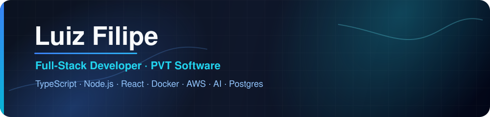

  

I build web products and internal tools with Next.js, TypeScript, Node.js, NestJS and PostgreSQL. Most of my work sits around operations, ERP integrations and AI features that need a real reason to exist.

At [PVT Software](https://www.pvtsoftware.com.br/), I work as a full stack developer on TOTVS RM integrations (REST/SOAP), SQL performance, blue/green production deploys and AI-assisted internal tools. That includes an anti-hallucination layer that cut SQL/ERP query authoring from 15 min to 5 min, and a portfolio query that went from 36s to 3s.

## GitHub dashboard

  
  

  

## Stack I use

  

## Contact

I am open to full stack, backend and applied AI work. Portuguese native, English C1.

  
  
  
  

